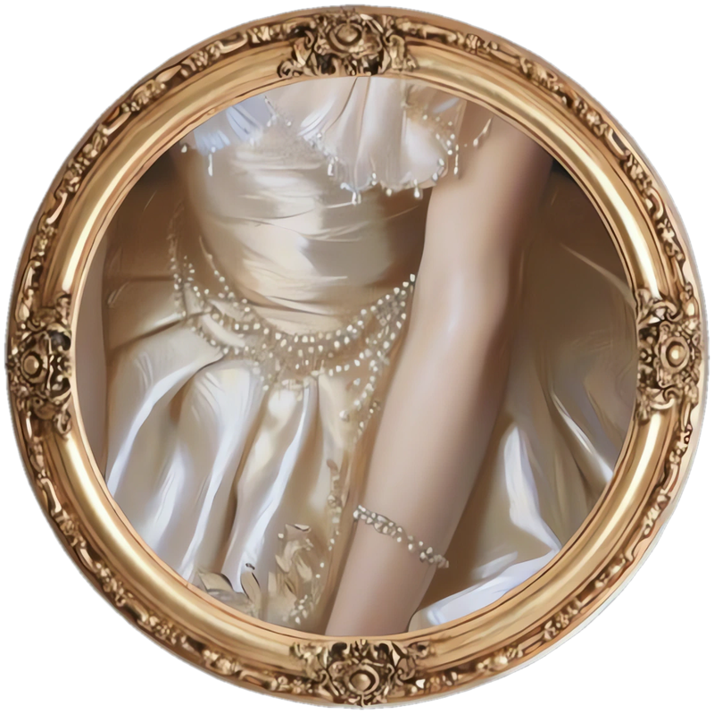

Hiiii, **it's tiny vee!! ✨** I'm a Multiplatform Software Engineering student with a creative mind that loves turning ideas into web and mobile apps. 💻📱 Frontend is where my heart is, though I also enjoy experimenting with other areas like backend and databases to see how everything connects. 🔧🗄️ I use AI as a tool to prototype faster, explore new concepts, and build better while keeping my own voice and judgment. 🤖✨ Outside of code, you'll usually find me listening to music, sipping coffee, or watching anime (Kuroshitsuji is a favorite).

always learning and crafting one detail at a time. ☕🎧🖤

 

### Languages & Markup

`Dart` · `JavaScript` · `TypeScript` · `Python` · `C` · `HTML5` · `CSS3`

### Frameworks

`Flutter`

### Design & Developer Tools

`Figma` · `Visual Studio Code` · `Git` · `GitHub`

### Strengths

`UI Design` · `Creative Direction` · `AI-Assisted Development` · `Clean Code` · `Rapid Prototyping`

 

 

 

<b>let's build something beautiful.</b>

Always learning, always creating.

